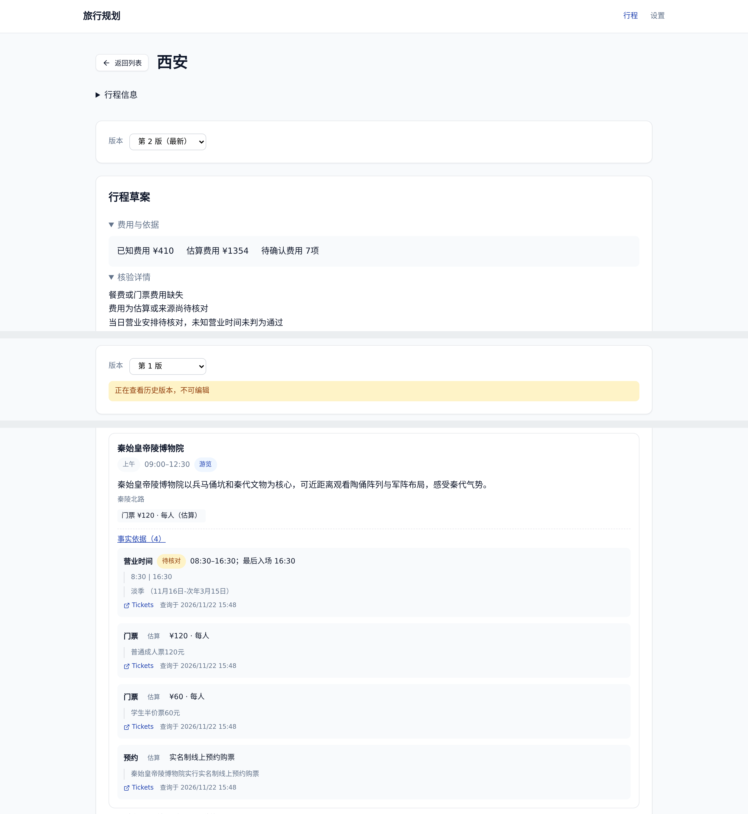
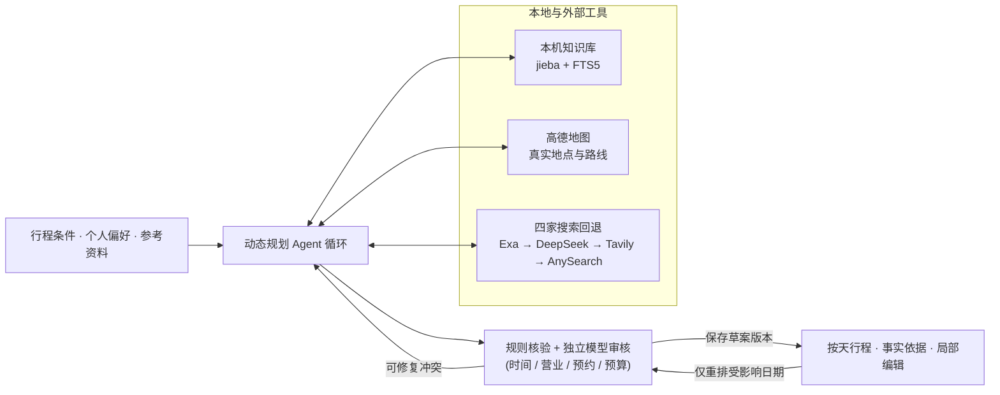

# 拾程 · 本地优先的旅行规划 Agent

> 把散落的攻略笔记、真实地图路线与可溯源的官网开放信息，整理成一份**随时可改、每一笔都能核对**的按天行程。

面向中文自由行用户，针对目的地与日期已确定的 **3–7 天中国大陆单城旅行**，结合你的个人参考资料、长期旅行习惯与实时公开信息，生成结构化的按天安排。单人本机部署，所有笔记、偏好与历史版本都留在你自己的设备里。

- **技术底座**：React 18 + TypeScript + Vite · FastAPI + Python 3.13 · SQLite (FTS5, Schema v6) · Docker Compose 单容器
- **技术报告**：查阅根目录的 [项目技术报告（PDF）](project-report.pdf)（LaTeX 源码位于 [docs/report/project-report.tex](docs/report/project-report.tex)）

<p align="center">
  
  
</p>

---

## 为什么是这样的设计

市面上的对话式旅游规划往往一口气生成漂亮的长文，却经不起落地推敲：闭馆日撞车、步行 4 公里被写成“顺路”、票价凭空编造、改一顿饭整份行程被重写。本项目把这些痛点拆解成了四条硬边界：

| 痛点 | 本项目的解法 |
| --- | --- |
| **开放时间与票价爱“脑补”** | **分离式事实核验**：提取阶段拆开保存地点身份、事实数值与日期适用规则原文，再由独立模型审核身份/语义/权威性，程序计算每周闭馆、跨年淡旺季与排除日期。没有官方原文支撑的内容绝不冒充“已核实”，诚实标为估算或待核对。 |
| **路线与节奏纸上谈兵** | **动态动作循环 + 独立审核**：LLM 按缺口自主决定查地点、查事实、查高德真实路线与生成/修复草案；规则引擎卡死营业区间、抵离缓冲、交通耗时与全团全程预算，独立质量审核再查重复游览与地理合理性，每步落盘检查点支持断电/超时重试。 |
| **改一个景点牵动整趟旅程** | **定点局部编辑 + 历史版本**：支持增删活动、替换地点、同日排序与指定跨日移动。重排与路线/事实刷新严格限定在受影响日期，其余日期逐字段保持原值，全团预算自动重算，旧版本只读留档随时切换。 |
| **个人笔记与偏好不好管** | **本机知识库与清晰优先级**：支持 PDF、文本、公开网页与收藏导入，本机 `jieba + SQLite FTS5` 分词定位；长期习惯用自然语言保存，**本次明确要求永远优先于长期偏好**，页面不输出生硬的“偏好匹配理由”，数据独立保存在本机。 |

> **餐饮与景点呈现原则**：景点与街区附简短特色介绍，不掺杂推荐理由或核验套话；餐饮默认采用**自由用餐时段**，仅以附近街区/景点作为交通锚点并标明餐费估算，不强行指定某家餐馆。

---

## 工作流一览



---

## 快速开始

应用提供 **Docker Compose** 与 **`git clone` 本机运行** 两种方式。只需填写你自己的 API 密钥即可启动完整规划；**即使暂未填写任何外部 Key**，启动后仍可正常体验行程录入、旅行偏好与参考资料管理。

### 方式一：Docker Compose 一键安装（推荐）

适合希望“一条命令跑起来、不污染本机 Python/Node 环境”的用户。需预先安装 Docker 及 Docker Compose v2.24+。

#### 1. 获取项目并准备配置

```sh
git clone <你的仓库地址> travel-planner
cd travel-planner
cp .env.example .env
```

打开 `.env`，填入你的模型与地图配置（详见下方[外部服务配置](#外部服务配置)）：

```dotenv
LLM_BASE_URL=https://api.deepseek.com
LLM_API_KEY=你的模型密钥
LLM_MODEL=deepseek-flash
AMAP_API_KEY=你的高德Web服务密钥

# 搜索默认按 Exa → DeepSeek → Tavily → AnySearch 顺序回退
# Exa 无 Key 时自动启用官方匿名 MCP；填 DEEPSEEK_API_KEY 可激活 DeepSeek Search/Fetch
SEARCH_PROVIDERS=exa,deepseek,tavily,anysearch
SEARCH_ALLOW_ANONYMOUS=true
DEEPSEEK_API_KEY=
```

#### 2. 构建并启动容器

```sh
docker compose build app
docker compose up -d --no-build --wait app
```

> **若网络访问 Docker Hub 较慢或受限**，可直接切换为 Amazon ECR Public 官方镜像源构建：
>
> ```sh
> docker compose build \
>   --build-arg PYTHON_IMAGE=public.ecr.aws/docker/library/python:3.13-slim-bookworm \
>   --build-arg NODE_IMAGE=public.ecr.aws/docker/library/node:24-bookworm-slim \
>   app
> docker compose up -d --no-build --wait app
> ```

#### 3. 启动后访问

```sh
curl http://127.0.0.1:8000/api/health
# 预期返回：{"status":"ok","schema_version":6}
```

打开本机浏览器访问 **`http://127.0.0.1:8000`** 即可使用（交互式 API 文档位于 `http://127.0.0.1:8000/api/docs`）。容器仅绑定回环地址 `127.0.0.1`，以非 root 用户（UID/GID `10001`）运行，数据持久化在命名卷 `travel-planner-data`。

- **修改 `.env` 后生效**：`docker compose up -d --no-build --force-recreate --wait app`
- **常用端口/数据卷自定义**：在 `.env` 中设置 `TRAVEL_PORT`、`TRAVEL_DATA_VOLUME`
- **日常停启**：`docker compose stop app` / `docker compose up -d --no-build --wait app`

---

### 方式二：`git clone` 本机运行（开发与调试）

适合直接阅读源码与本地调试前后端。前置依赖：**Python 3.13**、[**uv**](https://docs.astral.sh/uv/)、**Node.js 24 LTS**（含 `npm`）。

```sh
git clone <你的仓库地址> travel-planner
cd travel-planner
cp .env.example .env    # 按需填写 API 密钥

# 1. 安装锁定依赖并构建前端静态资源
uv sync --locked
npm --prefix web ci
npm --prefix web run build

# 2. 启动单进程后端服务（同时提供网页与 /api 接口）
uv run uvicorn travel_planner.main:app --host 127.0.0.1 --port 8000 --no-access-log
```

访问 **`http://127.0.0.1:8000`** 使用完整应用。默认本地数据存放在 `./data`。

**前后端热重载开发模式**：保持上方后端运行，在另一个终端启动 Vite 开发服务器（`/api` 请求自动代理至 `127.0.0.1:8000`）：

```sh
npm --prefix web run dev -- --host 127.0.0.1
```

---

## 外部服务配置

应用遵循**模型与搜索独立配置**原则，打开页面不会自动发起外部请求消耗额度；所有连通性检验均需在 **「设置 → 服务状态」** 页面手动触发，日志与页面响应均已脱敏。

| 服务类别 | 环境变量 | 说明 |
| --- | --- | --- |
| **大语言模型** | `LLM_BASE_URL`、`LLM_API_KEY`、`LLM_MODEL`、`LLM_JSON_MODE` | 支持任意 OpenAI 兼容 `/chat/completions` 接口（如 DeepSeek `deepseek-flash`）。 |
| **联网搜索与抓取** | `SEARCH_PROVIDERS`、`SEARCH_ALLOW_ANONYMOUS`、`EXA_API_KEY`、`DEEPSEEK_API_KEY`、`TAVILY_API_KEY`、`ANYSEARCH_API_KEY` | 默认回退顺序 **`exa,deepseek,tavily,anysearch`**。Exa 无 Key 时自动启用官方匿名 MCP；DeepSeek 对接 `POST /v1/tools/search` 与 `/v1/tools/fetch`；遇 429 自动共享冷却、遇 402/401 任务内切换下一家。 |
| **地点与路线** | `AMAP_API_KEY` | 高德 Web 服务 Key，负责同城 POI 消歧及步行/公交/驾车真实耗时与票价估算，内置限流退避与共享节流。 |
| **调用超时** | `PROVIDER_TIMEOUT_SECONDS` | 默认 `30` 秒；复杂多日规划或长正文核验建议设为 `120` 秒。 |

---

## 数据备份与恢复

应用提供离线维护工具 `travel-data`，在服务空闲并停止后可导出含 SQLite 单文件快照、全部原资料与 SHA-256 清单的 ZIP 归档，并支持校验与空目录/空卷恢复（`.env` 需单独保管）。

<details>
<summary><strong>点击展开：本机与 Docker 备份恢复命令</strong></summary>

**本机 `uv` 维护**：

```sh
# 确认应用空闲（idle: true）并停止 uvicorn 后执行
uv run travel-data --data-dir ./data verify
uv run travel-data --data-dir ./data backup --output ./backups/snapshot.zip
uv run travel-data --data-dir ./restored-data restore --archive ./backups/snapshot.zip
uv run travel-data --data-dir ./restored-data verify
```

**Docker Compose 数据卷维护**：

```sh
curl http://127.0.0.1:8000/api/runtime   # 确认 idle: true
docker compose stop app
mkdir -p backups
docker compose run --rm --no-deps --user 0:0 --entrypoint travel-data app --data-dir /data verify
docker compose run --rm --no-deps --user 0:0 --entrypoint travel-data --volume "${PWD}/backups:/backup" app --data-dir /data backup --output /backup/snapshot.zip
docker compose up -d --no-build --wait app
```

完整升级、回滚与空卷恢复步骤见 [部署与维护说明](docs/deployment.md)。

</details>

---

## 文档导航

| 分类 | 文档 | 内容概览 |
| --- | --- | --- |
| **技术报告** | [项目技术报告（PDF）](project-report.pdf) | 含系统架构、动态规划与事实核验设计、个人知识库及核心页面展示的 LaTeX 报告（[源码](docs/report/project-report.tex)）。 |
| **产品与架构** | [产品需求](docs/requirements.md) · [决策台账](docs/decisions.md) · [术语表](GLOSSARY.md) | 24 条已确认规则（R01–R24）、预算与编辑边界、领域概念定义及 3 份 ADR。 |
| **核心引擎** | [动态旅行规划](docs/agent-planning.md) · [首版实施设计](docs/implementation.md) · [技术栈选型](docs/tech-stack.md) | LLM 动作循环、独立审核、检查点恢复、数据契约（Schema v6）与 HTTP 接口边界。 |
| **外部接入** | [外部服务接入](docs/service-integration.md) · [搜索服务比较](docs/search-services.md) · [旅行 API 方案](docs/travel-apis.md) | 模型兼容契约、Exa/DeepSeek/Tavily/AnySearch 四家回退与高德适配。 |
| **开发与部署** | [后端开发说明](docs/backend.md) · [前端开发说明](docs/frontend.md) · [部署与维护说明](docs/deployment.md) | 本地启动、视觉规范（[design.md](design.md)）、容器发布与停服备份恢复。 |
