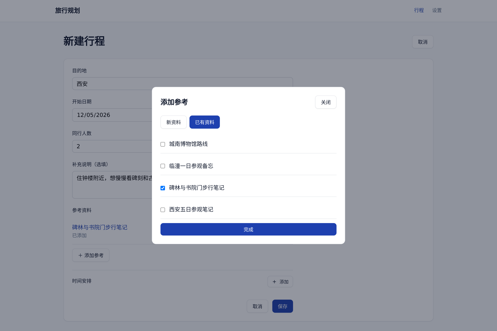
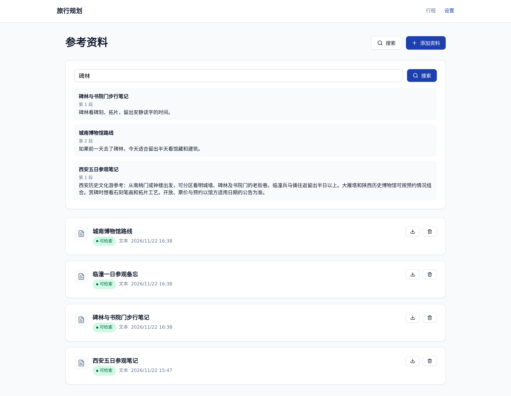
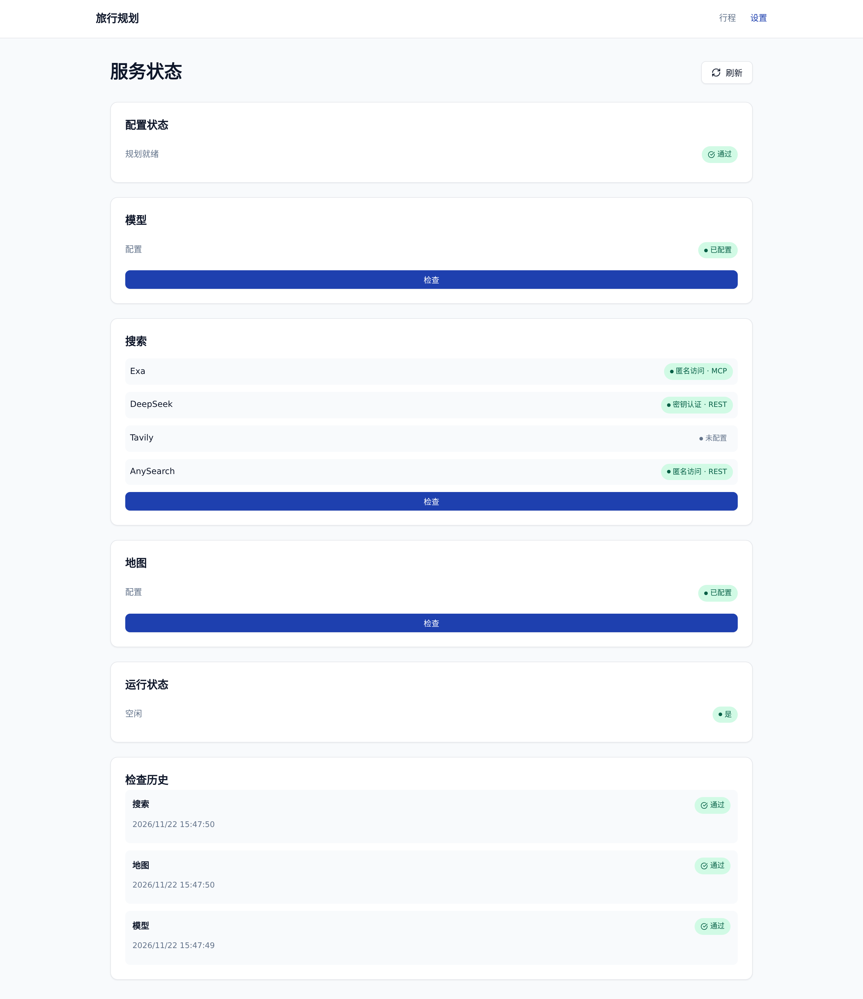
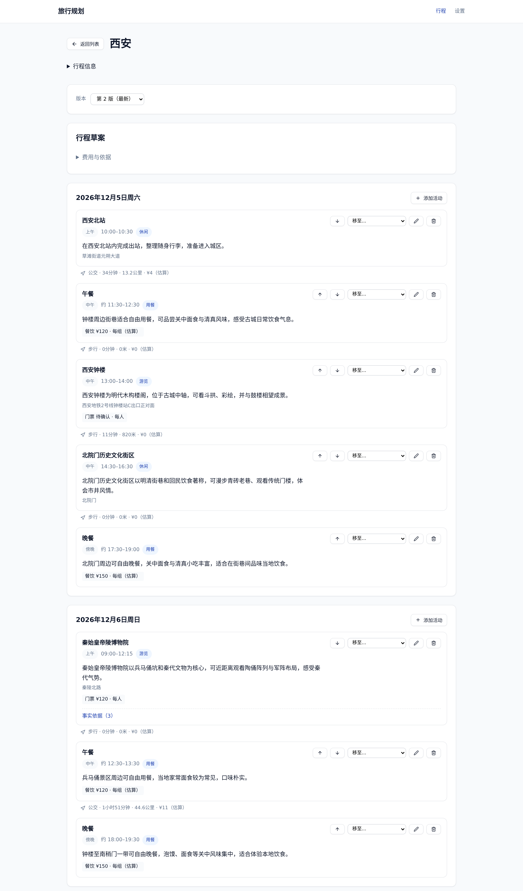
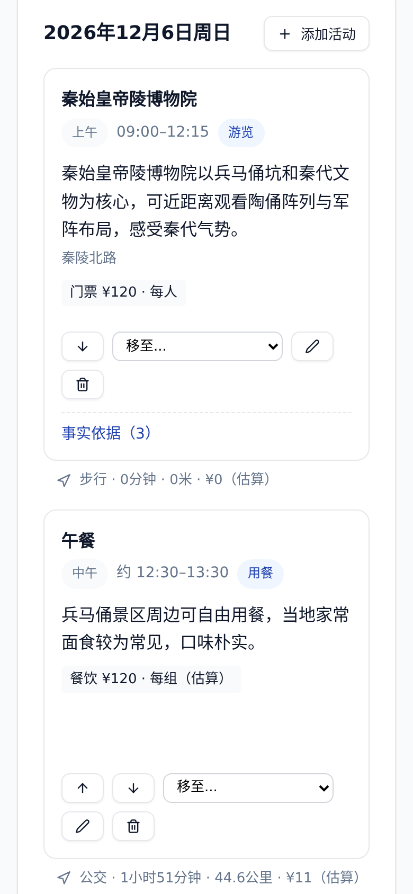
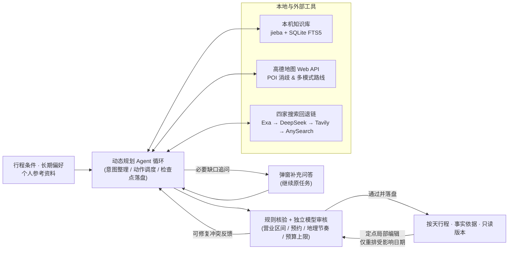

<div align="center">

# 拾程 · Travel Planner

**本地优先、事实可溯源、支持定点局部编辑的旅行规划 Agent**

面向中文自由行用户，针对目的地与日期已确定的 **3–7 天中国大陆单城行程**，<br />
将散落的攻略笔记、真实地图路线与可核验的公开开放信息，整理成一份**随时可改、每一笔都能核对**的按天行程。

<p>
  
  
  
  
  
  
  
</p>

<p>
  <a href="#核心理念与能力">核心能力</a> •
  <a href="#界面预览">界面预览</a> •
  <a href="#架构与工作流">架构与工作流</a> •
  <a href="#快速开始">快速开始</a> •
  <a href="#外部服务配置">外部服务配置</a> •
  <a href="#文档导航">文档导航</a>
</p>

</div>

---

市面上的对话式旅游规划往往一口气生成漂亮的游记长文，却经不起落地推敲：闭馆日撞车、步行 4 公里被写成“顺路”、票价凭空编造、改一顿饭整份行程被重写。

**拾程**采用**本地单机部署 + 透明工程边界**的设计：所有参考资料、旅行偏好、检查点与历史版本都留在你自己的设备中；只在规划需要时检索公开信息与真实路线，并把每一条核验依据、估算口径与变更版本清清楚楚摆在台面上。

> [!TIP]
> 想深入了解系统背后的设计取舍与细节？可直接阅读根目录的 **[项目技术报告（PDF）](project-report.pdf)**（LaTeX 源码位于 [docs/report/project-report.tex](docs/report/project-report.tex)）。

---

## 核心理念与能力

<table>
  <tr>
    <td width="50%" valign="top">
      <h3>🔍 分离式事实核验，拒绝“脑补”</h3>
      <p>提取阶段拆开保存<strong>地点身份、事实数值与日期适用规则原文</strong>，再由独立模型审核语义、实体对应与发布者权威性，最后由程序精确计算每周闭馆、跨年淡旺季与排除日期。</p>
      <ul>
        <li>没有可靠官方原文支撑的内容绝不冒充“已核实”</li>
        <li>明确区分 <code>已核实</code>、<code>估算</code> 与 <code>待核对</code>，保留来源链接与查询时间</li>
        <li>预约要求独立建档，存在冲突或缺失时主动提示</li>
      </ul>
    </td>
    <td width="50%" valign="top">
      <h3>🧭 动态动作循环与双重把关</h3>
      <p>规划器并非单次 Prompt 出图，而是由 LLM 依据信息缺口自主调度工具：检索本地知识库、调用高德 POI 消歧与路线测算、多源联网核查与草案生成修复。</p>
      <ul>
        <li><strong>规则引擎</strong>卡死营业区间、抵离缓冲、交通耗时与全团全程预算上限</li>
        <li><strong>独立审核</strong>排查重复游览、景区入口别名与全天节奏合理性</li>
        <li><strong>断点续跑</strong>：每步落盘至 <code>planning_checkpoints</code>，中断后可恢复重试</li>
      </ul>
    </td>
  </tr>
  <tr>
    <td width="50%" valign="top">
      <h3>✂️ 定点局部编辑与只读版本栈</h3>
      <p>改一个景点不必推翻整趟旅程。支持增删活动、替换地点、同日排序与指定跨日移动，变更影响被严格收敛。</p>
      <ul>
        <li>重排与路线/事实刷新<strong>严格限定在受影响日期</strong></li>
        <li>其余未动日期逐字段保持原值，全团预算自动联动重算</li>
        <li>每次修改自动生成新修订版，历史版本只读留档，随时切换对照</li>
      </ul>
    </td>
    <td width="50%" valign="top">
      <h3>🗂️ 本机知识库与克制的呈现原则</h3>
      <p>个人笔记、PDF 与网页攻略全部留在本地，采用 <code>jieba + SQLite FTS5</code> 分词检索，无需绑定第三方云盘或笔记账号。</p>
      <ul>
        <li><strong>清晰优先级</strong>：本次明确要求 &gt; 长期偏好档案 &gt; 个人参考资料</li>
        <li><strong>自由用餐时段</strong>：仅以附近街区/景点作交通锚点并标明餐费估算，不强行指定某家餐馆</li>
        <li>景点附简短特色介绍，不输出生硬的“偏好匹配理由”套话</li>
      </ul>
    </td>
  </tr>
</table>

---

## 界面预览

应用提供桌面端与移动端响应式界面，核心视图围绕**按天时间轴、事实依据核验、历史版本对照与本地知识库管理**展开：

<p align="center">
  
  
</p>
<p align="center">
  <em>左：行程列表首页 ｜ 右：费用汇总、核验详情、历史版本切换与事实依据溯源</em>
</p>

<details>
<summary><strong>📸 展开查看全部功能界面截图（行程创建 · 知识库检索 · 偏好配置 · 服务状态 · 移动端）</strong></summary>

<br />

| 新建行程与资料关联 | 本地知识库分词检索 |
| :---: | :---: |
|  |  |
| **长期旅行偏好档案** | **外部服务状态与连通性检查** |
|  |  |

<br />

| 五日按天行程长图示例 | 移动端响应式视图 |
| :---: | :---: |
|  |  |

</details>

---

## 架构与工作流

### 规划与核验闭环



### 仓库结构一览

<details>
<summary><strong>📂 查看项目目录与核心模块划分</strong></summary>

```text
.
├── backend/src/travel_planner/
│   ├── api/            # FastAPI 路由、请求校验与请求体限制中间件
│   ├── domain/         # 核心领域模型与统一错误定义
│   ├── planner/        # 动态动作循环、事实核验、独立审核、局部编辑与检查点
│   ├── knowledge/      # PDF/文本/公开网页解析、分段与 jieba + FTS5 索引服务
│   ├── providers/      # OpenAI 兼容 LLM、高德地图、Exa MCP 及多源搜索回退适配
│   ├── storage/        # SQLite (Schema v6) 迁移、实例锁与仓储层
│   ├── maintenance/    # travel-data 离线校验、SHA-256 备份与恢复工具
│   ├── config.py       # Pydantic Settings 环境配置与服务状态诊断
│   └── main.py         # 应用工厂与单进程静态资源/API 托管
├── web/src/
│   ├── pages/          # 行程列表、行程详情、参考资料、偏好、服务状态与设置页
│   ├── components/     # 按天时间轴、活动编辑器、参考选择器与澄清弹窗
│   └── utils/          # 路由、进度估算、错误处理与文本辅助
├── docs/               # 需求规则、ADR 决策台账、架构设计、部署手册与 LaTeX 报告
├── compose.yaml        # Docker Compose 单容器编排（非 root 运行，绑定 127.0.0.1）
├── Dockerfile          # Node 24 前端构建 + Python 3.13 / uv 多阶段镜像
└── .env.example        # 环境变量模板
```

</details>

---

## 快速开始

应用提供 **Docker Compose 单容器部署** 与 **本机源码运行** 两种方式。

> [!NOTE]
> **零密钥即可启动体验**：即使暂未填写任何外部 API Key，启动后仍可完整体验行程条件录入、长期旅行偏好编辑、以及本地参考资料导入与全文检索；配置模型、地图与搜索服务后即可解锁自动规划与事实核验。

### 方式一：Docker Compose 一键部署（推荐）

适合希望“一条命令跑起来、不污染本机 Python/Node 环境”的用户（需 Docker 及 Docker Compose `v2.24+`）。

#### 1. 获取源码与初始化配置

```sh
git clone <你的仓库地址> travel-planner
cd travel-planner
cp .env.example .env
```

编辑 `.env` 并填入模型与高德地图密钥（搜索回退默认开启，详见[外部服务配置](#外部服务配置)）：

```dotenv
LLM_BASE_URL=https://api.deepseek.com
LLM_API_KEY=你的模型密钥
LLM_MODEL=deepseek-flash
AMAP_API_KEY=你的高德Web服务密钥

# 搜索默认按 Exa → DeepSeek → Tavily → AnySearch 顺序回退
# Exa 无 Key 时自动启用官方匿名 MCP；填 DEEPSEEK_API_KEY 可激活 DeepSeek Search/Fetch
SEARCH_PROVIDERS=exa,deepseek,tavily,anysearch
SEARCH_ALLOW_ANONYMOUS=true
DEEPSEEK_API_KEY=
```

#### 2. 构建并启动服务

```sh
docker compose build app
docker compose up -d --no-build --wait app
```

<details>
<summary>🌐 若访问 Docker Hub 较慢或受限，点击展开 Amazon ECR Public 镜像源构建命令</summary>

```sh
docker compose build \
  --build-arg PYTHON_IMAGE=public.ecr.aws/docker/library/python:3.13-slim-bookworm \
  --build-arg NODE_IMAGE=public.ecr.aws/docker/library/node:24-bookworm-slim \
  app
docker compose up -d --no-build --wait app
```

</details>

#### 3. 健康检查与访问

```sh
curl http://127.0.0.1:8000/api/health
# 预期返回：{"status":"ok","schema_version":6}
```

打开本机浏览器访问 **`http://127.0.0.1:8000`** 即可使用（Swagger 交互式接口文档位于 `http://127.0.0.1:8000/api/docs`）。

<details>
<summary>⚙️ 容器安全边界与常用运维命令</summary>

- **隔离与持久化**：容器默认仅发布回环地址 `127.0.0.1:8000`，以非 root 用户（UID/GID `10001`）运行，数据持久化于命名卷 `travel-planner-data`。
- **常用端口/卷自定义**：在 `.env` 中设置 `TRAVEL_PORT` 或 `TRAVEL_DATA_VOLUME`。
- **更新 `.env` 后重建生效**：`docker compose up -d --no-build --force-recreate --wait app`
- **日常停启**：`docker compose stop app` / `docker compose up -d --no-build --wait app`

</details>

---

### 方式二：本机源码运行（开发与调试）

适合阅读源码或二次开发调试。前置依赖：**Python 3.13**、[**uv**](https://docs.astral.sh/uv/)、**Node.js 24 LTS**（含 `npm`）。

```sh
git clone <你的仓库地址> travel-planner
cd travel-planner
cp .env.example .env    # 按需填写 API 密钥

# 1. 安装锁定依赖并构建前端产物
uv sync --locked
npm --prefix web ci
npm --prefix web run build

# 2. 启动单进程后端服务（同时托管网页与 /api 接口）
uv run uvicorn travel_planner.main:app --host 127.0.0.1 --port 8000 --no-access-log
```

访问 **`http://127.0.0.1:8000`** 即可使用（本地数据默认保存在 `./data`）。

**前后端热重载开发模式**：保持上方后端进程运行，在另一个终端启动 Vite 开发服务器（`/api` 请求自动代理至 `127.0.0.1:8000`）：

```sh
npm --prefix web run dev -- --host 127.0.0.1
```

---

## 外部服务配置

应用遵循**模型、搜索与地图独立配置**原则：打开网页**不会**自动发起外部请求消耗额度；所有连通性检验均需在 **「设置 → 服务状态」** 页面手动触发，响应与日志均已完成密钥脱敏。

| 服务类别 | 环境变量 | 说明与行为 |
| --- | --- | --- |
| **大语言模型** | `LLM_BASE_URL`、`LLM_API_KEY`<br/>`LLM_MODEL`、`LLM_JSON_MODE` | 支持任意 OpenAI 兼容 `/chat/completions` 接口（如 DeepSeek `deepseek-flash`）。 |
| **联网搜索与抓取** | `SEARCH_PROVIDERS`、`SEARCH_ALLOW_ANONYMOUS`<br/>`EXA_API_KEY`、`DEEPSEEK_API_KEY`<br/>`TAVILY_API_KEY`、`ANYSEARCH_API_KEY` | 默认回退顺序 **`exa,deepseek,tavily,anysearch`**。Exa 无 Key 时自动启用官方匿名 MCP；DeepSeek 对接 `POST /v1/tools/search` 与 `/v1/tools/fetch`；遇 429 自动共享冷却、遇 402/401 任务内自动切换下一家。 |
| **地点与路线** | `AMAP_API_KEY` | 高德 Web 服务 Key，负责同城 POI 消歧及步行/公交/驾车真实耗时与票价估算，内置限流退避与共享节流。 |
| **超时与容器** | `PROVIDER_TIMEOUT_SECONDS`<br/>`TRAVEL_PORT`、`TRAVEL_DATA_VOLUME` | `PROVIDER_TIMEOUT_SECONDS` 默认 `30` 秒（复杂多日规划或长正文核验建议设为 `120` 秒）。 |

---

## 数据安全与离线备份

所有行程、修订版、知识库原文与全文索引均持久保存在本地设备。项目内置离线维护工具 `travel-data`，可在服务空闲并停止后导出包含 **SQLite 单文件快照 + 全部原资料 + SHA-256 清单**的 ZIP 归档，并支持完整性校验与向空目录/空卷无损恢复（`.env` 密钥文件需单独保管）。

<details>
<summary><strong>💾 展开查看本机与 Docker 备份 / 校验 / 恢复命令</strong></summary>

**本机 `uv` 维护**（确认应用空闲 `idle: true` 并停止 `uvicorn` 后执行）：

```sh
uv run travel-data --data-dir ./data verify
uv run travel-data --data-dir ./data backup --output ./backups/snapshot.zip
uv run travel-data --data-dir ./restored-data restore --archive ./backups/snapshot.zip
uv run travel-data --data-dir ./restored-data verify
```

**Docker Compose 数据卷维护**：

```sh
curl http://127.0.0.1:8000/api/runtime   # 确认 idle: true
docker compose stop app
mkdir -p backups
docker compose run --rm --no-deps --user 0:0 --entrypoint travel-data app --data-dir /data verify
docker compose run --rm --no-deps --user 0:0 --entrypoint travel-data --volume "${PWD}/backups:/backup" app --data-dir /data backup --output /backup/snapshot.zip
docker compose up -d --no-build --wait app
```

完整升级、回滚与空卷恢复流程请参见 [部署与维护说明](docs/deployment.md)。

</details>

---

## 文档导航

| 主题分类 | 文档入口 | 内容概览 |
| --- | --- | --- |
| **技术报告** | [项目技术报告（PDF）](project-report.pdf) · [LaTeX 源码](docs/report/project-report.tex) | 完整阐述系统架构、动态规划循环、事实核验机制、知识库检索与界面设计。 |
| **产品与决策** | [产品需求](docs/requirements.md) · [决策台账](docs/decisions.md) · [领域术语表](GLOSSARY.md) | 24 条产品规则（R01–R24）、预算与局部编辑边界、领域术语及 3 份架构决策记录（ADR）。 |
| **核心引擎** | [动态旅行规划](docs/agent-planning.md) · [首版实施设计](docs/implementation.md) · [技术栈选型](docs/tech-stack.md) | LLM 动作循环、独立审核、检查点恢复、SQLite Schema v6 与 HTTP 接口边界。 |
| **外部接入** | [外部服务接入](docs/service-integration.md) · [搜索服务比较](docs/search-services.md) · [旅行 API 方案](docs/travel-apis.md) | OpenAI 兼容契约、Exa / DeepSeek / Tavily / AnySearch 四家回退链与高德路线适配。 |
| **开发与运维** | [后端开发说明](docs/backend.md) · [前端开发说明](docs/frontend.md) · [部署与维护说明](docs/deployment.md) | 本地开发环境、界面视觉规范（[design.md](design.md)）、容器发布与离线备份恢复。 |
