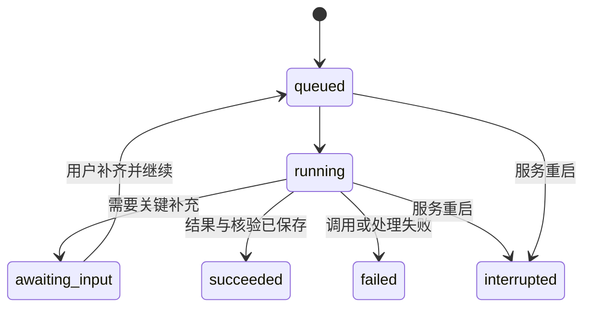

# 首版实施设计

2026-11-17：规划生成已改为由 LLM 选择查询、生成与修复动作，独立模型审核反馈驱动下一轮；实际工作状态与运行边界见[动态旅行规划](agent-planning.md)。下文固定流程描述保留作为首版实施基线。

状态：可用于分解开发任务的实施基线。产品行为以[需求](requirements.md)和[决策台账](decisions.md)为准；本文件细化模块、数据、接口和交付顺序，技术参数在对应样本测试中校准。

## 模块与界面

| 模块 | 职责 | 页面上的行为 |
| --- | --- | --- |
| 行程输入 | 结构化条件、关键缺口判断、假设记录。 | 新建行程表单与补充对话；保存后可重新打开。 |
| 偏好与知识库 | 偏好编辑、资料导入、索引、查看与删除。 | 显示导入中、可检索、失败状态，原资料定位与偏好更新确认。 |
| 规划任务 | 排队、阶段推进、任务记录、重试、重启处理。 | 按实际阶段展示状态；刷新或关闭网页后能恢复查看。 |
| 外部服务 | 模型、搜索回退、地点、路线适配。 | 显示可读的配置或调用错误；来源侧栏可查看证据。 |
| 行程与核验 | 按天安排、费用汇总、营业时间与路线检查、局部编辑。 | 编辑活动并查看新版本；明确显示冲突或待核实项。 |
| 安装与数据 | 配置检查、持久化、迁移、备份与恢复。 | 本机访问，服务状态页显示配置是否齐全，密钥在 `.env` 配置。 |

计划目录为 `web/`、`backend/`、`tests/fixtures/`、`scripts/` 和 `docs/`。后端按 `api`、`domain`、`planner`、`knowledge`、`providers`、`storage` 分工，继续由一个应用容器运行。原型先使用表单、行程卡片和编辑按钮，复用已选 React 与 FastAPI。

## 数据契约

所有业务对象使用应用生成的稳定 ID。记录时间使用带时区的时间戳；中国大陆行程使用 `Asia/Shanghai`。日期为 `YYYY-MM-DD`，起止日期均计入天数，首版为 3–7 天；人数为正整数。金额保存为整数分，币种为 CNY。

| 对象 | 必需信息 | 关系与状态 |
| --- | --- | --- |
| `TripRequest` | `id`、`revision`、目的地名称、起止日期、同行人数、可选预算、明确要求、本次重点、已知条件、假设。 | 目的地解析后关联行政编码；用户要求与假设分别保存。修改条件生成新版本。 |
| `PreferenceProfile` | 单实例偏好集合、版本、更新时间。 | 当前行程可覆盖；档案更新仅来自用户直接编辑或明确确认。 |
| `KnowledgeSource` | 来源类型、标题、URL 或文件引用、内容摘要值、导入状态和错误。 | `pending → processing → ready / failed`；保存原文与可定位片段。 |
| `KnowledgeChunk` | 资料 ID、片段序号、正文、页码或段落定位、索引文本。 | FTS5 引用同一片段 ID，删除和更新同步处理。 |
| `PlanJob` | 行程请求版本、任务状态、当前阶段、错误、创建与更新时间、结果版本。 | 保存状态后才能返回提交成功；密钥留在运行配置中。 |
| `Place` | 提供方地点 ID、名称、地址、坐标、坐标系、城市信息、查询时间。 | 地点 ID 与位置用于消歧，名称不是唯一标识。 |
| `FactEvidence` | 事实类型、事实值、单位、来源 URL／定位、来源类型、查询与抓取时间、适用日期、状态。 | 状态为有依据、估算、冲突或未知；冲突保留各来源。私人资料片段与公开事实证据分开管理。 |
| `ItineraryRevision` | 行程 ID、版本、引用的请求版本、各天活动、相邻交通、费用、证据 ID、核验结论。 | 新结果另存版本，当前可见版本以一次事务替换。 |
| `ValidationIssue` | 规则、严重程度、涉及的活动／交通／费用、依据、具体原因。 | 区分已知冲突与未知；不能把未知记为条件已满足。 |

SQLite 用普通表保存上述对象的身份、关系和任务状态；单个行程版本的活动树可保存为经过校验的 JSON，减少首版表间更新。迁移记录数据库版本，查询只返回明确可用的导入内容。

### 时间、交通与预算

- 页面按早中晚展示；内部为活动保存计划开始、结束及停留时长，以分钟表达排程估计。检查活动是否落在日期对应的营业区间，并满足“前项结束＋交通时间不晚于后项开始”。
- 抵达、离开和已有预约时间是明确约束。日内活动时段缺失时形成可见假设；不得将未知营业时间补成已核实值。跨午夜营业区间按日期展开。
- 路线耗时保留查询时间与估算标记；地址、坐标或路线无法确认时标记对应问题。请求范围由本次城市决定。
- 费用项明确为按人、按组或固定项，汇总为所有同行者的全程费用。儿童、优惠资格等会改变票价时追问或标记估算，不推断用户具有优惠资格。
- 已知费用超过预算时必须指出冲突；部分费用未知时只能展示已知小计和未知项。未填写预算则不运行预算上限规则。
- 无法满足硬约束时返回冲突及可调整条件，不自动放宽用户要求；其余可用内容可保留为草案。

## 规划任务生命周期

`succeeded` 表示任务产生了可读结果；结果另外保存 `passed / needs_review / blocked` 核验状态，分别表示已检查条件通过、存在未知、存在已知冲突。页面展示具体条件，避免把任务成功等同于事实全部核实。

执行器一次领取一个规划任务，排队顺序按提交时间。`awaiting_input` 不占用执行器；用户补充后按新的请求版本继续。重启将旧 `running/queued` 标为 `interrupted`，保留 `awaiting_input` 和已完成结果；用户重试创建新任务并关联原任务。重复提交使用请求标识去重，避免网页重发生成两个任务。

阶段为条件整理、资料检索、网络取证、地点与路线、生成、核验和保存。模型格式修复及行程自动修复各最多追加两轮，达到上限后显示具体失败或冲突。请求超时用于终止无响应调用，不作为产品生成耗时目标。搜索每个候选每次只尝试一次，沿用[回退规则](service-integration.md#回退规则)。

首次实现由客户端轮询任务状态，已保存的状态足以恢复页面。配置检查只验证格式、凭据是否存在及模式；带真实调用的连通性检查作为独立测试动作记录，避免打开页面就消耗服务额度。

## HTTP 接口边界

| 接口 | 行为 |
| --- | --- |
| `GET /api/health`、`GET /api/config/status` | 健康状态、已配置服务及鉴权模式，返回脱敏信息。 |
| `POST /api/trips`、`GET /api/trips`、`GET /api/trips/{id}` | 创建和查看行程要求、当前版本及待补充项。 |
| `PATCH /api/trips/{id}` | 提交条件或对话补充，携带期望版本；过期版本返回冲突。 |
| `POST /api/trips/{id}/jobs`、`GET /api/jobs/{id}` | 提交规划返回 `202 + job_id`，查询任务阶段、结果或失败。 |
| `POST /api/jobs/{id}/retry` | 失败或中断任务重新提交；成功任务不重复执行。 |
| `POST /api/jobs/{id}/resume` | 保存补充后的新要求版本，继续等待输入的任务。 |
| `GET /api/trips/{id}/itinerary`、`PATCH /api/trips/{id}/itinerary` | 查看和编辑草案；编辑携带活动操作及基础版本，进入重新核验任务。 |
| `GET /api/trips/{id}/places?q=地点名称` | 按本次城市查询供编辑选择的地点，保留具体地点 ID 与地址。 |
| `GET /api/preferences`、`PUT /api/preferences` | 查看与用户主动保存偏好。模型提出的偏好更新先留在页面待确认。 |
| `POST /api/knowledge`、`GET /api/knowledge`、`GET /api/knowledge/{id}`、`DELETE /api/knowledge/{id}` | 导入文件／文本／URL、查看状态与定位片段、删除原资料及索引。 |

错误统一包含可判定代码、可读原因、是否可重试及涉及对象。编辑接口接受 `add/remove/replace/move` 等活动操作；提交后旧版本继续可读，只有新版本核验记录完整时才保存为当前草案。版本检查失败返回 `409`，提示加载最新行程。

自动重排限定用户修改所涉及的日期，跨日移动明确给出目标日期。其他日期的活动保持原值，预算重新汇总；修改失败保留原版本。稳定活动 ID 避免靠数组位置误改活动。

## 资料检索与证据

导入按页或段落提取文本，使用有长度上限的分段，保存原始定位；正文和查询使用同一中文分词。首轮以约 800 个中文字符、相邻约 100 字重叠、最多返回 8 个去重片段作为内部可调起点，并按模型上下文总预算裁剪。索引空结果时继续使用明确偏好与公开资料，同时说明个人资料未命中。

偏好档案直接按本次覆盖规则读取，不依赖关键词召回。知识库查询结合目的地、地点别名、兴趣与限制；跨城市通用资料可以命中，错误城市的地点内容不能冒充本次地点依据。

解析工作串行并设超时、内存上限，异常资料记为失败；原资料完成解析与索引后才进入 `ready`。重复内容按摘要值复用或提示，失败导入不计为可用资料。

删除资料先在事务中禁用检索并清理片段与全文索引，再清理文件；失败清理可重试。发送模型请求前重新检查引用资料仍可用，避免排队任务复用已删除片段。已有行程内容仍作为用户保存的草案保留，后续检索不从已删除资料的片段缓存读取。

每个新规划任务重新查询时效性事实，同一任务内对等价查询复用结果。查询时间、来源发布时间与事实适用日期分别保存；只有来源明确说明新旧规则替代关系时才能解决冲突，否则保持可见。资料与网页内容作为数据传入，模型只能引用已有地点和来源 ID；应用校验新增或不存在的引用。

## 个人安装、数据与升级

镜像构建网页，运行时为一个 Python 服务；以 `linux/amd64` 为首个镜像平台，宿主机仅发布回环地址端口。运行数据统一放入挂载目录，包含 SQLite、资料和索引，配置与密钥独立保存在 `.env`。

首版交付 `compose.yaml`、`Dockerfile`、`.env.example`、依赖锁定文件和 Windows 安装说明。安装者先启用受支持的 Docker Desktop Linux 容器环境，复制配置、填写模型及高德 Key，并按需填写搜索 Key；Exa 和 AnySearch 允许按已选规则匿名。未配置必要服务时显示配置缺口，历史行程与资料仍可读取。

首个原型支持本地构建镜像，提供构建命令和版本标签；镜像仓库发布作为交付步骤配置，不将尚未发布的镜像地址写成可用安装入口。当前后端容器与离线维护工具的命令见[部署说明](deployment.md)。

升级流程为等待任务结束、停服、导出完整数据卷、更新镜像、运行版本迁移、启动并检查数据。迁移失败停止启动并报告原因；回滚使用旧镜像加对应升级前备份，不直接让旧代码读取已迁移的数据。恢复先写入空卷，检查数据库版本、资料数与行程，再切换应用使用。

网页资料抓取只访问公开 HTTP(S) 地址，验证每次重定向，避免资料 URL 指向本机数据和凭据端点；用户明确配置的模型基址独立处理，可指向自建模型服务。网页展示按文本或清理后的内容渲染，日志只保存脱敏调用状态。这些规则归入 URL 导入与配置接入实现。

## 工作包与完成条件

| 顺序 | 工作包 | 依赖 | 完成证据 |
| --- | --- | --- | --- |
| W1 | 项目骨架、配置、SQLite 迁移、数据契约与静态网页入口。 | 当前规划 | 本地启动、无 Key 配置提示、数据写入后重启保留；接口契约可校验。 |
| W2 | 模型、Exa REST/MCP、Tavily、AnySearch、高德适配和回退。 | W1 | 录制样本与可联网环境真实调用分别记录，覆盖 A22、A27–A31。 |
| W3 | 偏好、文本/PDF/URL 导入、分词检索与删除。 | W1 | A06、A13、A15–A17、A21、A25 通过。 |
| W4 | 单任务执行器、取证、生成、时间/费用核验与保存。 | W2、W3 | 西安三天完整任务，A01–A11、A18–A20 通过。 |
| W5 | 行程编辑、版本检查、3–7 天与目的地切换。 | W4 | A12、A23、A24 及边界/版本案例通过；其他日期不被自动重写。 |
| W6 | Windows 安装、备份恢复、完整回归与个人试用。 | W5 | 安装/升级记录、A26 及全量案例报告、一次真实用户采用评价。 |

天气作为首版后的可选增强，不阻塞以上工作包。具体依赖版本在 W1 锁定，超时、分段和检索条数随样本调整；用户已经确定的范围、预算口径、搜索顺序与模型配置方式不随技术调参改变。

## 实施进度（2026-11-22）

| 工作包 | 当前交付与验证 |
| --- | --- |
| W1 | 后端项目、uv 锁定依赖、配置检查、Schema v6 事务迁移、行程要求与版本、自然语言偏好及静态网页入口已实现；无 Key 启动、重启保留和接口验证通过。React 网页已接入真实 API，28 组 Playwright 流程与 38 状态 axe-core（0 违规）通过，见[2026-11-22 浏览器验收报告](validation/2026-11-22-frontend.json)。 |
| W2 | 兼容模型、Exa REST／MCP、DeepSeek Search／Fetch、Tavily、AnySearch、高德适配与四家顺序回退已实现；显式连通性检查记录入库。固定响应与真实 MCP SDK 测试通过，Exa 匿名 MCP、DeepSeek 独立密钥 Search/Fetch 及高德限流退避已完成真实调用验证。 |
| W3 | 文本／PDF／URL／收藏导入、原资料附件下载、定位分段、jieba＋FTS5 检索、行程级参考资料关联与删除清理已实现；100 份中文资料容量压测及 26 页排版 PDF、纯图片扫描 PDF、3,083 字攻略、官网 URL、收藏与本机回环 SSRF 抽查通过。 |
| W4 | 任务持久化与串行执行、去重、补充弹窗、重试、重启中断、动态 LLM 动作循环、分离式三段引用事实核验、独立审核与检查点恢复已实现。完成西安五日游真实规划（0 硬冲突、`needs_review`）及个人偏好真实大模型 A/B/C 对照，见[2026-11-22 西安五日游验收](validation/2026-11-22-xian-five-days.md)。 |
| W5 | 活动增删替换、同日排序、指定跨日移动、局部重排及审核降级容错已实现；后端 349 项、前端 60 项测试全通过，实测西安五日游局部编辑后其余四天逐字段保持原值、票款晋升已核实且历史版本只读一致。 |
| W6 | 提供多阶段 Dockerfile、Compose、运行状态和停服 `travel-data` 校验／备份／空卷恢复 CLI；Linux 容器构建（Schema v6 + 最新前端资源 SHA-256 校验）、非 root 运行、回环端口、容器替换与空卷恢复通过，见[2026-11-22 容器验收报告](validation/2026-11-22-container.json)。项目完整报告见根目录 [project-report.pdf](../project-report.pdf)。 |

接口样例、当前解析参数与完整本地验证记录见[后端开发与验证](backend.md)。
