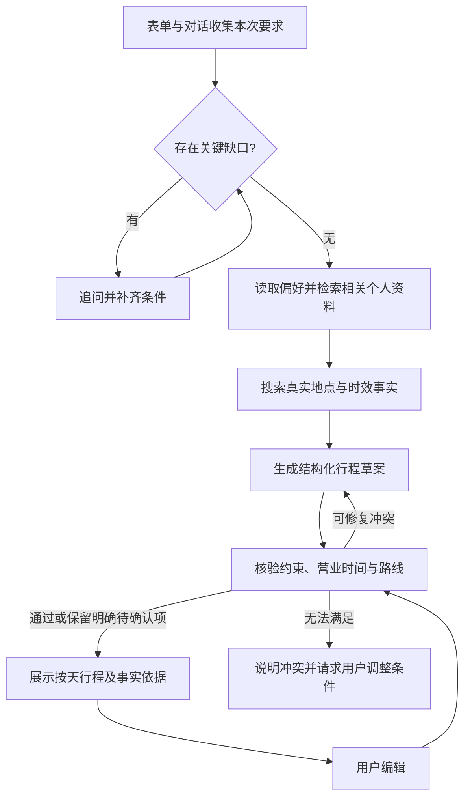

# 推进计划

本文依据[已确认需求](requirements.md)组织实施阶段与验证。产品范围、预算口径、编辑规则和技术方案已确认，后端已建立资料检索、外部服务接入、规划编辑与数据维护能力。

2026-11-15 完成规划完整性检查，接口、任务状态、数据契约和安装升级的实施基线已补入[首版实施设计](implementation.md)。当前满足开始实施的条件；外部 API 和 Windows 验收尚待执行，状态见[检查记录](planning-review.md)。

## 阶段与交付物

| 阶段 | 任务 | 交付物与退出条件 |
| --- | --- | --- |
| M0：确定验证场景 | 已确定西安验证场景、Windows x64 安装目标、旅行预算、编辑范围与简化技术方案。 | 需求、技术栈、决策与验收文档记录一致结论，实施设计可分解为 W1–W6。 |
| M1：验证数据可用性 | 在西安选取景点、餐饮和交通样本，核对地点服务、网络搜索与官方信息，并检查服务支持运行时传入其他国内城市。 | 一组具有地点标识、位置和事实依据的候选记录；记录来源缺失与冲突，形成供应商选择依据。 |
| M2：打通三日规划 | 使用一份文本资料和一组偏好，完成条件整理、检索、搜索、生成、核验与编辑，并验证 Docker 安装流程。 | 在选定环境可安装并完成一次规划与修改；时效事实能追溯到来源，未知项有明确状态；重建容器后个人数据保留。 |
| M3：补齐首版范围 | 扩展到 3–7 天，接入 PDF、文本、链接与收藏；补齐偏好查看、编辑、删除和确认更新。 | 已确认需求均有可演示行为和对应验收记录；不同安装实例的数据独立及资料删除行为通过验证。 |
| M4：案例与试用验收 | 运行固定案例，由使用者完成西安旅行的规划、调整与评价。 | 检查安装是否顺利、明确约束是否符合、来源是否可核对，以及用户能否修改并愿意采用行程。 |

M1 的供应商选择需要核对实际接口、样本响应和使用条款，优先采用西安数据可用、容易接入的服务。基础技术栈已确定为 React + TypeScript + Vite、FastAPI、Python 显式流程和 SQLite；知识库检索与外部服务按[技术栈选型](tech-stack.md)继续推进。生成耗时与 API 调用费用不设目标。

当前已核对 DeepSeek 兼容聊天接口、五家搜索服务的额度与接入形式，以及高德地点路线和天气服务。模型基址、密钥与名称由用户配置，DeepSeek 用于首轮验证；详见[外部服务接入方案](service-integration.md)。Exa 匿名搜索与正文已取得真实响应；其余账号调用、安装网络与证据适用性继续验收。

## 个人安装验证

Docker Compose 启动一个应用容器，镜像构建阶段生成网页，运行阶段由 FastAPI 提供网页与 API。SQLite 和原始资料写入持久化卷，用户通过 `.env` 配置外部服务，修改后重启生效。

首个安装验收目标为 Windows（Intel／AMD），通过本机浏览器访问。使用 Docker Desktop 的 Linux 容器环境，镜像目标为 `linux/amd64`；按说明在应用空闲并停止后手动导出数据卷，恢复到空卷后核验。

安装验证覆盖首次启动、服务重启、容器替换后的数据保留，以及按说明备份和恢复。规划任务在网页关闭后继续执行，进程异常后将未完成任务呈现为失败或中断并允许重试，已有完成结果仍可读取。

## 规划流程

用普通 Python 函数与显式阶段协调模型和工具；一次运行一个规划任务，其余排队。模型负责理解、候选组织与草案生成，可判定的约束交给规则检查；应用保存阶段状态、管理请求超时与有限重试。请求失败或修复达到上限时，记录具体原因并允许用户重试。

用户可以增删活动、替换地点和调整顺序。自动调整限定在受影响当天，其他日期保留；跨日变动由用户明确指定。修改后核验相关活动、相邻交通及全团全程预算，费用信息不足时保留待核实状态。

## 数据契约概览

以下是对象责任划分，字段格式、任务状态、编辑版本和接口边界以[首版实施设计](implementation.md)为准。

| 对象 | 建议保存的信息 | 需要保持的关系 |
| --- | --- | --- |
| `TripRequest` | 目的地、起止日期、同行人数、已知出入城与住宿条件、可选预算、明确限制、本次重点、采用的假设。 | 预算为全体同行者、全程门票餐饮与当地交通总额，单位人民币；单人费用按人数计入，共享费用避免重复计算。 |
| `PreferenceProfile` | 当前安装实例的已确认偏好、更新时间。 | 本次覆盖长期偏好时保留原档案，更新另行确认。 |
| `KnowledgeSource` | 资料类型、标题、原始引用、导入时间、可定位的相关片段。 | 片段能回溯到本实例的原资料，检索限于当前实例。 |
| `Place` | 地点标识、名称、类别、地址、坐标与地点服务来源。 | 同名地点依靠标识和位置区分；活动引用具体地点。 |
| `FactEvidence` | 所支持的事实、值及单位、来源 URL、来源类型、查询时间、适用日期、核实状态。 | 依据关联到具体事实；查询时间与事实适用日期分别保存，冲突来源均可追溯。 |
| `Itinerary` | 日期、早中晚分组、活动顺序、预估停留时间、交通方式与耗时、费用估算、事实依据引用。 | 地点、交通与费用能追溯到来源或估算说明；支持用户编辑。 |
| `ValidationIssue` | 对应规则、涉及活动或交通、冲突或未知原因、可调整项。 | 事实未知与已知冲突分别记录；影响是否可采用的事项在行程中可见。 |

页面按早中晚展示，内部活动开始、结束及交通耗时以分钟保存为排程估计，并按日期与时区核验营业区间和预约。已知时间作为明确约束，缺失时间以可见假设或未知状态表示。

## 首个技术验证任务

用西安、三天行程、一份文本资料和一组明确偏好形成首个验证案例。三天是首个验证样本，首版产品范围仍是 3–7 天。

目的地作为 `TripRequest` 输入，贯穿资料检索、网络搜索、地点查询、路线查询和生成流程。以西安作为主要验证样本，并补充一次切换到其他中国大陆城市的验收。

输入包含西安、确定日期、同行人数、按约定口径表达的预算、兴趣与限制。个人资料至少包含一条会影响候选选择的内容；准备一项本次要求覆盖长期偏好的情况。

完成以下可演示结果：

1. 形成明确的本次要求，必要缺口经过追问补齐。
2. 检索出与当前旅行有关的资料片段，搜索并确认真实地点。
3. 给出三天的活动、餐饮与交通安排，事实依据能关联到具体项目。
4. 展示营业时间、路线与明确约束的核验结果，缺失或冲突信息明确呈现。
5. 用户完成一次行程修改，看到更新后的核验结果；长期偏好保持到用户确认更新时才改变。

## 技术验证记录

每次试验记录输入条件、资料版本、搜索与地点服务、模型配置、来源查询时间、核验结果和人工修改。耗时、调用量与费用保留为调试信息，不构成验收门槛。固定案例保留数据快照以便复现；在线样本另外记录来源变化，帮助区分规划错误和信息更新。

模型配置以 DeepSeek 作为验证样例，再检查兼容基址与模型切换；搜索按 Exa → Tavily → AnySearch 回退，用同一组西安查询核对来源、正文与日期。Exa 无 Key 时使用官方匿名 MCP，Tavily 未配置时跳过，AnySearch 按配置使用认证或匿名模式；测试限流冷却、额度耗尽和全部失败的状态。

阶段退出按[验收设计](acceptance.md)检查。供应商选型和试用结论应附对应样本与测量结果。

## 当前执行状态

M0 规划已完成；M1 已完成公开文档核对与 Exa 匿名搜索／正文真实调用，其余供应商账号与来源样本继续验收。M2–M3 已实现后端资料与服务接入、W4 规划生成核验及 W5 活动编辑；固定响应覆盖西安三天、杭州七天规划和编辑，实际 HTTP 验证编辑进程中断恢复。W6 已提供后端容器配置、运行状态与离线校验／备份／恢复，非开发安装及恢复后继续规划编辑通过验证。下一步执行容器、Windows 安装和真实账号端到端验收；M4 用户试用待执行。启动和验证记录见[后端开发与验证](backend.md)，安装操作见[部署说明](deployment.md)，后续顺序见[实施工作包](implementation.md#工作包与完成条件)。
