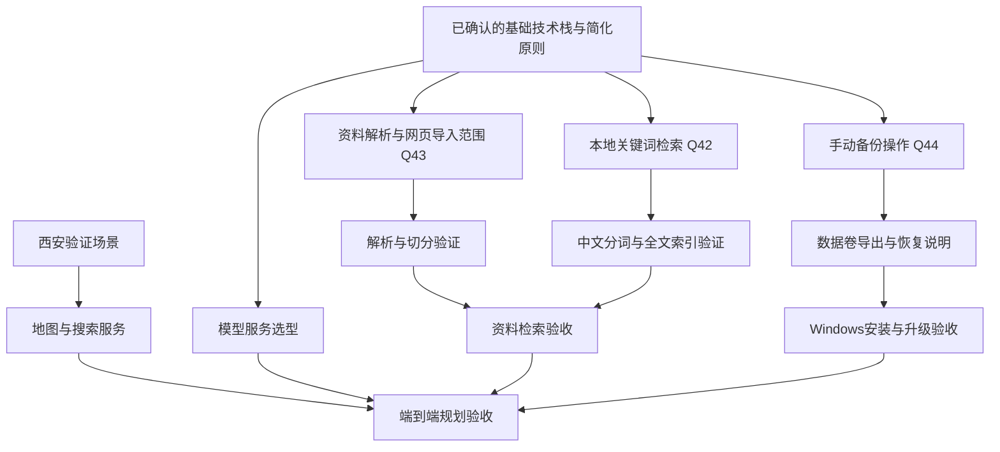

# 技术栈选型

状态：基础技术栈与简化方案已确认，验证使用西安，首个安装验收目标为 Windows（Intel／AMD）。生成耗时和 API 调用费用不设目标，后续工作转入服务接入与原型验证。

模块、数据格式、接口、任务状态及交付步骤见[首版实施设计](implementation.md)，规划完整性与实际执行状态见[检查记录](planning-review.md)。

## 已选技术栈

| 层次 | 已确认方案 |
| --- | --- |
| 网页 | React + TypeScript + Vite，构建为静态页面。 |
| 服务端 | FastAPI，提供 API 与构建后的网页。 |
| 模型接入 | 用户配置 `base_url + api_key + model`，采用 OpenAI 兼容 Chat Completions；验证时使用 DeepSeek。 |
| 网页搜索 | Exa → DeepSeek → Tavily → AnySearch 顺序回退；Exa 无 Key 时使用官方匿名托管 MCP。 |
| Agent | Python 动作执行循环，LLM 动态选择查询、生成和修复，独立模型审核反馈；应用负责引用校验、状态、超时和调用上限。 |
| 任务执行 | 进程内一次运行一个规划任务，其余排队；任务状态持久化，异常中断后由用户重试。 |
| 业务存储 | SQLite 保存偏好、行程、任务与资料元数据；原始资料存于持久化目录。 |
| 知识库检索 | 中文分词与 SQLite FTS5 本地关键词检索，命中片段与结构化偏好用于规划。 |
| 资料解析 | pypdf 提取文字型 PDF，Trafilatura 提取公开网页正文；读取失败时由用户补充文本。 |
| 备份 | 应用空闲并停止后手动导出完整数据卷，按说明恢复；`.env` 单独保管。 |
| 安装 | Docker Compose 启动单个应用容器，本机浏览器访问；Windows x64 为首个验收平台。 |
| 外部服务配置 | `.env` 分别配置模型与搜索、地图服务；模型三项为 `LLM_BASE_URL`、`LLM_API_KEY`、`LLM_MODEL`，修改后重启生效。 |
| 初始资料容量 | 100 份以内，单份最多 20 MB，PDF 最多 200 页；按真实样本验证。 |

## 已确定的选型依据

- 响应式网页承载表单、补充对话和可编辑行程。
- 资料处理、安装与维护尽量简单，优先复用已选组件和直接的数据流。
- 受控的单 Agent 流程串联个人资料检索、网络搜索、行程生成和规则核验。
- 每个安装实例供一个人使用，独立保存该使用者的资料、偏好和行程；偏好更新需要用户确认。
- 资料包含可提取文字的 PDF、文本、链接和收藏；首版扫描件提示用户提供文字版本。
- 采用 Docker Compose 提供单应用容器的个人安装方式。
- 首发在个人电脑安装，通过本机浏览器访问；首个验收平台为 Windows（Intel／AMD）。
- 采用 Python 服务端与 TypeScript 网页；数据保存于安装设备，由使用者配置外部 API 密钥。
- 外部服务优先选择国内直连可用的提供方，并允许配置；实际连通性在安装设备上核验。
- 用户关闭网页后，主机与服务仍运行时规划继续；进程异常后允许标记失败并由用户重试。
- 允许外部 AI 服务处理必要片段，服务需要符合已确认的数据处理要求。
- 西安用于首轮验证；实际目的地由用户选择，首版覆盖中国大陆的单城行程，目标行程长度为 3–7 天。生成耗时和 API 调用费用不设验收目标。
- 后端基础与资料导入检索已建立，已锁定 Python 依赖；实际交付与验证见[后端开发与验证](backend.md)。

产品依据见[需求](requirements.md)，历史结论见[决策台账](decisions.md)。

## 决策树

## 已收敛的范围

Q32 已明确为每份安装供单人使用，之前的多人服务容量目标撤回。Q33 的托管优先建议已被 Q35 确认的安装设备本地持久化替代。

| 问题 | 已确认结论 |
| --- | --- |
| Q24 | 西安作为验证城市；实际使用时用户可选择其他中国大陆城市。 |
| Q25 | 旅行预算选填，人民币、全体同行者、全程门票与餐饮及当地交通总额；填写后作为上限。 |
| Q26 | 增删活动、替换地点、调整顺序；自动调整仅影响相关当天，跨日变动由用户指定。 |
| Q27 | 生成耗时与 API 调用费用不设目标，验收以行程质量与可用性为主。 |
| Q28 | Python 负责规划与资料处理，TypeScript 负责网页。 |
| Q29 | 优先选择国内直连可用的外部服务，允许配置提供方。 |
| Q30 | 主机与服务运行时，关闭或刷新网页不影响已提交任务；进程异常后允许失败并由用户重试。 |
| Q31 | 首版支持可提取文字的 PDF，扫描件识别后续加入。 |
| Q34 | 个人电脑安装，本机浏览器访问。 |
| Q35 | 资料、偏好和行程持久化在安装设备，由用户配置外部 API 密钥。 |
| Q36 | 首个 Docker 安装验收使用 Windows（Intel／AMD）。 |
| Q37 | React + TypeScript + Vite 构建网页，FastAPI 提供页面与 API，Compose 启动单个应用容器；开发时前后端分别调试。 |
| Q38 | SQLite 保存业务数据和资料元数据，原始文件保存在本地持久化目录；检索采用 Q42 确定的 SQLite FTS5。 |
| Q39 | 普通 Python 函数组织受控阶段，显式管理状态、超时与有限重试；一次执行一个规划任务，其余排队。 |
| Q40 | 初始容量目标为 100 份以内资料，单份最多 20 MB，PDF 最多 200 页。 |
| Q41 | `.env` 配置外部服务，服务端使用并提供检查结果，修改后重启生效；配置与个人数据备份分别管理。 |
| Q42 | 本地提取文字、分段和中文关键词检索，将命中片段与偏好交给规划模型。 |
| Q43 | 基础 PDF 文字提取与公开网页正文提取；失败时提示粘贴文本或上传文件。 |
| Q44 | 停服后手动导出完整数据卷，按说明恢复，`.env` 单独保管。 |
| 模型选择补充 | DeepSeek 仅用于验证，实际使用由用户自行填写兼容服务的基址、密钥和模型名称。 |
| 搜索回退补充 | Exa、DeepSeek、Tavily、AnySearch 依次尝试，成功后停止；按 Key 配置决定官方认证或匿名入口，尊重服务限流。 |

## 简化方案

以下方案已确认，实施时按样本核验资料质量、检索效果和恢复完整性。

| 决策 | 实现 | 验证重点 |
| --- | --- | --- |
| Q42 个人资料检索 | 资料提取文字后分段，资料与查询使用一致的中文分词，SQLite FTS5 检索并返回来源片段。 | 西安、碑林等短词与地点别名的召回；资料删除后索引同步清理。 |
| Q43 PDF 与网页解析 | pypdf 解析文字型 PDF，Trafilatura 提取公开网页正文；失败时保存失败状态并提示用户补充内容。 | PDF 页码、正文顺序、空内容及解析资源限制。 |
| Q44 备份与恢复 | 固定命令停服后导出数据卷，恢复到空卷后核验；`.env` 单独保管。 | 数据库、资料与全文索引的一致性，原有行程与偏好可读取。 |

这一组合以本地文本处理和现有 SQLite 为核心，保持当前仅发送规划所需资料片段的规则。知识库检索质量通过相关资料、地点别名、短词和偏好覆盖案例验证。

## 单人安装结构

应用由浏览器、单个 FastAPI 应用容器、SQLite 与文件持久化存储以及外部 API 组成。镜像构建时生成网页静态资源，运行时由 Python 服务提供网页与 API。镜像目标为 `linux/amd64`，在 Windows 的 Docker Desktop Linux 容器环境验收；网页发布端口绑定 `127.0.0.1`，数据挂载到持久化卷。

应用安装与数据保存分开设计，使更换应用容器后能继续读取已有资料、偏好与行程。SQLite 写入保持短事务，资料解析移出异步事件循环；检索索引和备份按 Q42–Q44 实现。SQLite 选型原因见[存储决策](adr/0003-sqlite-and-local-files.md)。

## 后续选型方法

模型验证使用 DeepSeek，实际使用支持用户配置兼容服务；网页搜索采用 Exa → DeepSeek → Tavily → AnySearch 回退。免费量与付费 Key 形式见[搜索服务比较](search-services.md)，高德与天气等能力见[旅行 API 方案](travel-apis.md)，回退状态、MCP 匿名入口和配置见[外部服务接入方案](service-integration.md)。

服务接入依据当前官方文档和可运行样本推进，记录接口能力、来源字段及实际账号配置结果。

验证使用西安的同一组资料与行程案例，比较解析与检索质量、事实依据关联、硬约束核验、任务失败后的处理和用户修改体验。耗时与费用可作为调试记录，不作为选型或验收门槛。将已确认的选择同步到决策台账；涉及长期数据边界或明显迁移成本的选择，再单独记录 ADR。

按 Q25 的全团全程旅行预算和 Q26 的当日编辑范围设计接口。供应商支持中国大陆城市，并接受运行时传入的目的地；用西安样本核对数据质量、接口可用性、依据可追溯性及接入复杂度。资料检索、搜索、地点与路线查询均使用本次行程的目的地条件。

## 已核对的技术事实

### Docker

| 事实 | 对本项目的影响 | 官方依据 |
| --- | --- | --- |
| Compose 使用配置文件描述服务；`docker compose up -d` 创建并在后台启动服务。 | 可作为个人安装的统一启动入口，具体配置待应用结构确定。 | [应用模型](https://docs.docker.com/compose/intro/compose-application-model/)、[启动命令](https://docs.docker.com/reference/cli/docker/compose/up/) |
| 数据写入命名卷并在重建后挂载同一卷，可跨容器删除或替换保留；`down -v` 会删除受管理的命名卷。 | 数据卷与数据库备份需要明确管理，安装说明区分停止服务和删除数据。 | [数据卷](https://docs.docker.com/engine/storage/volumes/) |
| 端口映射默认绑定主机所有接口；显式绑定 `127.0.0.1` 可将发布端口限定在主机回环地址。 | 先决定本机使用还是跨设备访问，再确定端口配置。 | [发布端口](https://docs.docker.com/get-started/docker-concepts/running-containers/publishing-ports/)、[Compose ports](https://docs.docker.com/reference/compose-file/services/#ports) |
| Docker Desktop 包含 Engine、CLI 和 Compose；Linux 也可以分别安装 Engine、CLI 和 Compose 插件。 | 按实际目标系统编写安装前提。 | [Compose 安装](https://docs.docker.com/compose/install/) |
| `linux/amd64` 与 `linux/arm64` 需要对应的镜像变体；多平台镜像能在同一标签下提供不同变体。 | 根据目标设备选择构建与验证的架构。 | [多平台镜像](https://docs.docker.com/build/building/multi-platform/) |

### Agent 编排

通过 Context7 查询的 [LangGraph 检查点文档](https://docs.langchain.com/oss/python/langgraph/checkpointers)说明，保存与恢复流程需要检查点机制和 `thread_id`；持久化模式影响进程崩溃时能够恢复到哪里。[Functional API 文档](https://docs.langchain.com/oss/python/langgraph/functional-api)进一步说明，恢复会从检查点边界重放，外部调用等操作需要明确的任务边界。

Q30 已选择进程异常后允许失败并重试，Q39 已确认用 Python 显式流程与持久化任务记录实现这一行为。检索、搜索、生成、核验各阶段及有限重试由应用组织。

### 网页与服务端

- Vite 提供 React + TypeScript 模板，`vite build` 生成可静态托管的产物。见[入门](https://vite.dev/guide/)和[生产构建](https://vite.dev/guide/build.html)。
- FastAPI 可以托管静态目录，单页应用的客户端路由需要明确配置回退页面。见[静态文件](https://fastapi.tiangolo.com/tutorial/static-files/)和[前端托管](https://fastapi.tiangolo.com/tutorial/frontend/)。
- FastAPI 的生命周期机制可管理应用资源，普通后台任务在进程内执行；后台执行本身不提供进程崩溃后的恢复。见[生命周期](https://fastapi.tiangolo.com/advanced/events/)、[后台任务](https://fastapi.tiangolo.com/tutorial/background-tasks/)和[Starlette 后台任务](https://www.starlette.io/background/)。

上述能力支持 Q37 已选结构。Q39 所需的任务记录、排队、超时、重启状态处理和同步解析隔离需要应用实现；单应用进程中由生命周期管理执行器，提交接口先保存任务并返回标识，再由执行器处理。网页查询已保存的阶段与结果；耗时同步解析移出事件循环。

### SQLite

SQLite 官方将个人应用和设备的本地数据存储列为适用场景；它作为库直接访问本地数据库文件，不需要独立数据库服务。数据库写入需要串行进行。见[适用场景](https://www.sqlite.org/whentouse.html)、[应用文件格式](https://www.sqlite.org/appfileformat.html)和[无服务进程设计](https://www.sqlite.org/serverless.html)。

Q38 已确认将 SQLite 用于单实例的业务数据，数据库放在本机 Docker 持久化卷中。全文索引使用 SQLite FTS5，按 Q40 的容量目标验证；备份流程保证数据库与原始资料一致。

### 全文检索

SQLite FTS5 的默认 `unicode61` 将连续的字母或数字类别字符视为一个词项，中文检索需要额外分词设计；`trigram` 全文查询不能匹配少于三个 Unicode 字符的子串。因此在应用层对资料与查询做一致的中文分词，再交由 FTS5 建索引，并用“西安”“碑林”等短词验证召回。见[FTS5 分词器](https://www.sqlite.org/fts5.html)。

### 资料解析

pypdf 可逐页提取 PDF 文字并保留页码，适合已经确认的文字型 PDF 范围；多栏和表格内容的读取顺序需要样本验证。PDF 压缩后的文件大小与页数不能单独限制解析内存，建议采用受时间、内存与并发限制的解析子进程，失败时返回具体导入状态。见[pypdf 文字提取](https://pypdf.readthedocs.io/en/stable/user/extract-text.html)。

Trafilatura 可提取 HTML 正文和元数据，处理 JavaScript 渲染内容需要外部渲染步骤，登录内容需要相应会话。Q43 已确定直接处理可取得正文的公开网页，失败时保留 URL 并让用户粘贴正文或上传文件。资料导入保存用户选定内容；运行时的营业时间与票价等事实仍需要重新取得依据。见[Python 用法](https://trafilatura.readthedocs.io/en/latest/usage-python.html)和[提取问题](https://trafilatura.readthedocs.io/en/latest/troubleshooting.html)。
